# Azure Hub-and-Spoke Network

A small but complete model of how companies build networks in Azure: a central hub with shared services and separate spoke networks for dev and prod. All traffic between environments and to the internet is forced through one control point, Azure Firewall, and every decision is logged.

The whole environment is described as code (Bicep), deployed in phases, and verified with evidence: command output and Firewall logs.

---

### Goals

What this project demonstrates:

- Designing a network with non-overlapping address ranges and room to grow
- Isolating dev and prod, so they cannot reach each other directly
- Centralizing traffic control in one Firewall instead of scattered rules
- Least privilege with a second layer of defense (NSG + ASG)
- Proving the result with logs instead of claiming it works
- Governance with Azure Policy and cost control for expensive resources
- Infrastructure as Code with a modular Bicep structure and phased deployment

---

### Architecture
```text
                          Internet
                             ▲
                             │  only allowed FQDNs (Ubuntu updates)
                  ┌──────────┴───────────┐
                  │       vnet-hub       │
                  │     10.0.0.0/22      │
                  │                      │
                  │  ┌────────────────┐  │   ┌────────────────┐
                  │  │ Azure Firewall │  │   │ Azure Bastion  │
                  │  └────────────────┘  │   └────────────────┘
                  └───────┬──────────┬───┘
              VNet peering│          │VNet peering
                          │          │
              ┌───────────┴──┐    ┌──┴───────────┐
              │   vnet-dev   │    │  vnet-prod   │
              │  10.1.0.0/16 │    │ 10.2.0.0/16  │
              │              │    │              │
              │  vm-dev-01   │    │ vm-prod-01   │
              └──────────────┘    └──────────────┘
                     ▲                  ▲
                     └──── no direct ───┘
                           peering
```

---

### Traffic rules

| #  | From        | To            | Port / protocol | Result      | Enforced by                |
| -- | ----------- | ------------- | --------------- | ----------- | -------------------------  |
| 1  | dev         | prod          | 80, 443 (TCP)   | ✅ Allowed  | Firewall + NSG             | 
| 2  | dev         | prod          | 22 (SSH)        | ❌ Blocked  | Firewall + NSG             |
| 3  | prod        | dev           | any             | ❌ Blocked  | Firewall + NSG             |
| 4  | dev / prod  | Ubuntu repos  | 80, 443 (FQDN)  | ✅ Allowed  | Firewall application rule  |
| 5  | dev / prod  | internet      | any other       | ❌ Blocked  | Firewall (deny by default) |
| 6  | admin       | VMs           | SSH via browser | ✅ Allowed  | Azure Bastion              |
| 7  | internet    | VMs           | any             | ❌ Blocked  | No public IPs              |

---

### Key Design Decisions

| Decision                                  | Rationale                                                                                                                                     |
| ----------------------------------------- | --------------------------------------------------------------------------------------------------------------------------------------------- |
| Hub-and-Spoke topology                    | Shared services are centralized in the hub, while workloads are isolated in separate spokes.                                                  |
| No peering between Dev and Prod           | VNet peering is not transitive, preventing direct communication between the environments through the network topology.                        |
| UDR `0.0.0.0/0` → Firewall private IP     | Routes outbound and inter-spoke traffic through Azure Firewall instead of allowing it to bypass the firewall.                                 |
| Default-deny Firewall policy              | All traffic is denied by default. Only explicitly authorized and documented traffic is allowed.                                               |
| NSG on every workload subnet              | Provides an additional security layer, reducing the impact of incorrectly configured Firewall rules.                                          |
| ASGs instead of IP addresses in NSG rules | Rules reference application roles, such as `web-servers`, rather than individual IP addresses, making them easier to maintain.                |
| Subnets without default outbound access   | VMs without public IP addresses access the internet through Azure Firewall rather than relying on implicit outbound connectivity.             |
| Azure Bastion instead of public SSH       | Enables secure VM management without exposing SSH or RDP ports directly to the internet.                                                      |
| Azure Policy                              | Enforces governance requirements, such as preventing public IP assignments to NICs, requiring resource tags, and restricting allowed regions. |
| Phased deployment                         | Deploys the low-cost network foundation first and provisions the more expensive Azure Firewall only when needed for testing.                  |

---

### Address plan

| Network     | Range          | Size              | Why                                                       |
| ----------- | -------------- | ----------------- | --------------------------------------------------------- |
| `vnet-hub`  | `10.0.0.0/22`  | 1,024 addresses   | Only shared services, room for Firewall, Bastion and more |
| `vnet-dev`  | `10.1.0.0/16`  | 65,536 addresses  | Large spoke with room to grow                             |
| `vnet-prod` | `10.2.0.0/16`  | 65,536 addresses  | Large spoke with room to grow                             |

All ranges come from the private `10.0.0.0/8` block, and the second octet identifies the network (`10.0` hub, `10.1` dev, `10.2` prod), so the environment of any address is obvious at a glance. The hub is a `/22` because it holds only a few service subnets (three `/26` subnets for Firewall, Firewall management and Bastion) and needs just some room to grow. The spokes are `/16`, because they are the networks that grow with the workloads, and a large range avoids resizing them later. In a real company the spokes would usually be smaller to save address space, but for a lab simplicity matters more.

Ranges do not overlap. This matters because overlapping ranges break peering and cannot be fixed easily in a working network.

### Subnets

| Network     | Subnet                          | Range            | Purpose                                      |
| ----------- | ------------------------------- | ---------------- | -------------------------------------------- |
| `vnet-hub`  | `AzureFirewallSubnet`           | `10.0.0.0/26`    | Azure Firewall (name is mandatory, min. /26) |
| `vnet-hub`  | `AzureBastionSubnet`            | `10.0.0.64/26`   | Azure Bastion (name is mandatory, min. /26)  |
| `vnet-hub`  | `AzureFirewallManagementSubnet` | `10.0.0.128/26`  | Only if the Basic Firewall SKU is used       |
| `vnet-dev`  | `snet-dev-workload`             | `10.1.1.0/24`    | Dev virtual machines                         |
| `vnet-prod` | `snet-prod-web`                 | `10.2.1.0/24`    | Prod web servers                             |

---

### Azure resources

| Resource                | Name                                                                 | Notes                                       |
| ----------------------- | -------------------------------------------------------------------- | ------------------------------------------- |
| Resource group          | `rg-hubspoke-lab`                                                    | One container, easy to delete               |
| Virtual networks        | `vnet-hub`, `vnet-dev`, `vnet-prod`                                  | See address plan                            |
| VNet peering            | `hub-to-dev`, `dev-to-hub`, `hub-to-prod`, `prod-to-hub`             | Both directions required                    |
| Azure Firewall          | `afw-hub`                                                            | SKU: `Basic`                                |
| Firewall policy         | `afwp-hub`                                                           | Deny by default                             |
| Route tables            | `rt-dev`, `rt-prod`                                                  |`0.0.0.0/0` → Firewall private IP            |
| NSGs                    | `nsg-dev`, `nsg-prod`                                                | Least privilege                             |
| ASGs                    | `asg-web`                                                            | "All web servers"                           |
| Azure Bastion           | `bas-hub`                                                            | Basic SKU or higher (see notes)             |
| Virtual machines        | `vm-dev-01`, `vm-prod-01`                                            | Ubuntu, no public IP                        |
| Log Analytics workspace | `law-hubspoke`                                                       | Firewall logs and KQL queries               |
| Azure Policy assignments| `deny-nic-public-ips`, `require-env-tag`, `allowed-locations-poland` | Step 14, scoped to the resource group       |

### Tags

All resources use the same tags. Four of them are fixed, and `deployment` records which tool created the resources, so it changes with the deployment method:

| Name         | Value                                   |
| ------------ | --------------------------------------- |
| `project`    | `hub-spoke`                             |
| `owner`      | `illia`                                 |
| `env`        | `lab`                                   |
| `deployment` | `portal`, `bicep` or `terraform`        |
| `purpose`    | `Pet-Project`                           |

| Deployment method | Value of `deployment` |
| ----------------- | --------------------- |
| Azure Portal      | `portal`              |
| Bicep             | `bicep`               |
| Terraform         | `terraform`           |

The tag makes it easy to see how any resource was created, and to filter or compare resources from different phases in **Cost Management** and in the resource list.

---

### Project structure

```text
azure-hub-spoke/
│
├── infrastructure/
│   ├── main.bicep                  # Orchestrates the modules
│   ├── modules/
│   │   ├── network.bicep           # VNets, subnets, peering, NSG, ASG
│   │   ├── firewall.bicep          # Firewall, policy, rules, diagnostics
│   │   ├── routing.bicep           # Route tables (UDR)
│   │   ├── compute.bicep           # Test virtual machines
│   │   ├── bastion.bicep           # Azure Bastion
│   │   ├── monitoring.bicep        # Log Analytics workspace
│   │   └── policy.bicep            # Azure Policy assignments
│   └── main.bicepparam             # Parameters and phase switches
│
├── docs/
│   ├── address-plan.md             # Why these ranges
│   ├── test-matrix.md              # Test results with evidence
│   ├── cost.md                     # Cost notes and cost log
│   ├── lessons-learned.md          # What went wrong and how it was fixed
│   └── screenshots/
│
├── scripts/                        # Helper scripts (tests, shutdown, cleanup)
│
├── .github/
│   └── workflows/
│       └── validate.yml            # Compile Bicep on every change
│
├── .gitignore
├── LICENSE
└── README.md
```

---

### Prerequisites

- An [Azure account](https://azure.microsoft.com/free/) and permission to create resources and policy assignments in the subscription
- [Azure CLI](https://learn.microsoft.com/cli/azure/install-azure-cli) and Bicep:

```powershell
az --version
az bicep install
az bicep version
```

---

## Deployment using Azure Portal

Open the [Azure Portal](https://portal.azure.com/).  

## Phase 1 — Network foundation

### Step 1 — Create a Resource Group

In the search bar, enter:

```text
Resource groups
```

Click **Resource groups → Create**. Configure the resource group:

| Setting          | Value                     |
| ---------------- | ------------------------- |
| `Subscription`   | `Azure subscription 1`    |
| `Resource group` | `rg-hubspoke-lab`         |
| `Region`         | `Poland Central`          |

Open the **Tags** tab and add:

| Name         | Value             |
| ------------ | ----------------- |
| `project`    | `hub-spoke`       |
| `owner`      | `illia`           |
| `env`        | `lab`             |
| `deployment` | `portal`          |
| `purpose`    | `Pet-Project`     |

Click **Review + create**.

After validation completes, click **Create**.

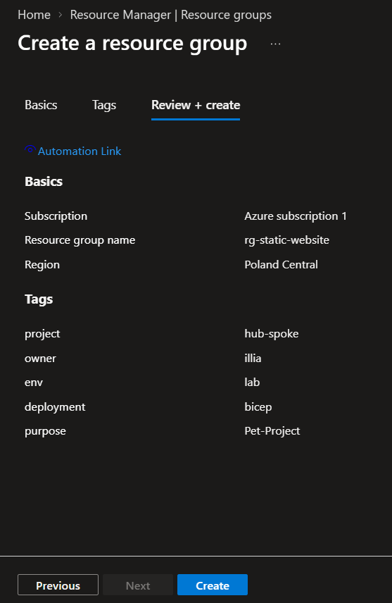

### Step 2 — Create the hub virtual network

In the search bar, enter:

```text
Virtual networks
```

Click **Virtual networks → Create**. On the **Basics** tab:

| Setting                | Value                   |
| ---------------------- | ----------------------- |
| `Subscription`         | `Azure subscription 1`  |
| `Resource group`       | `rg-hubspoke-lab`       |
| `Virtual network name` | `vnet-hub`              |
| `Region`               | `Poland Central`        |

The hub virtual network is the shared core of the architecture. It hosts the services that every environment needs, so they exist once instead of being duplicated in each spoke.

Without a hub, each environment would need its own Azure Firewall and its own Azure Bastion. That means paying for two hourly-billed services, maintaining two sets of rules that tend to drift apart, and reading logs in two places. Connecting dev and prod directly with peering would be even worse, because the environments could reach each other with no inspection at all.

With a hub, dev and prod are peered only to vnet-hub and never to each other. VNet peering is not transitive, so the spokes cannot see one another directly. Route tables on the spoke subnets send 0.0.0.0/0 to the private IP of the Azure Firewall in the hub, so any traffic between environments, and any traffic to the internet, passes through a single control point. The firewall policy then decides what is allowed (for example, dev to prod on ports 80 and 443, and Ubuntu updates by FQDN) and denies everything else by default. Every decision is written to one Log Analytics workspace, so a single KQL query shows what was allowed or blocked and why.

The hub also hosts Azure Bastion, which gives browser-based SSH access to the VMs in both spokes. The VMs have no public IPs and no inbound SSH port is exposed to the internet.

The hub is deliberately small (10.0.0.0/22), because it contains only service subnets (AzureFirewallSubnet, AzureBastionSubnet and AzureFirewallManagementSubnet) and no workloads. The spokes get large ranges (/16), because that is where the workloads live.

The design also scales: adding a new environment means creating a new spoke VNet, peering it to the hub and attaching a route table. The firewall, Bastion and logging are already in place. This is the same pattern used by Azure Landing Zones in production environments.

On the **Security** tab leave Azure Bastion, Azure Firewall and DDoS protection **disabled**. They are created separately later.

On the **IP addresses** tab remove the default address space and subnet, then set:

| Setting             | Value          |
| ------------------- | -------------- |
| `IPv4 address space`| `10.0.0.0/22`  |

Add the subnets:

| Subnet name                      | Range            | Note                                       |
| -------------------------------- | ---------------- | ------------------------------------------ |
| `AzureFirewallSubnet`            | `10.0.0.0/26`    | Exact name is mandatory, minimum size `/26`|
| `AzureBastionSubnet`             | `10.0.0.64/26`   | Exact name is mandatory, minimum size `/26`|
| `AzureFirewallManagementSubnet`  | `10.0.0.128/26`  | Only for the Basic Firewall SKU            |

Which octet changes depends on the subnet size, not on a personal choice. Azure suggests /24 by default, which is 256 addresses, so each new subnet moves the third octet (10.0.0.0, 10.0.1.0, 10.0.2.0). We use /26, which is 64 addresses, so the subnets step through the fourth octet (10.0.0.0, 10.0.0.64, 10.0.0.128). /26 is the minimum size Azure allows for AzureFirewallSubnet and AzureBastionSubnet, and a /24 would waste 256 addresses on a service subnet that needs far fewer. In the spoke VNets the workload subnets are /24 (10.1.1.0/24, 10.2.1.0/24), because that is where the VMs live.

Open the **Tags** tab and add the tags.

| Name         | Value             |
| ------------ | ----------------- |
| `project`    | `hub-spoke`       |
| `owner`      | `illia`           |
| `env`        | `lab`             |
| `deployment` | `portal`          |
| `purpose`    | `Pet-Project`     |
 
Click **Review + create**, then **Create**.
 
**Result:** the central network that will hold the shared services.
 
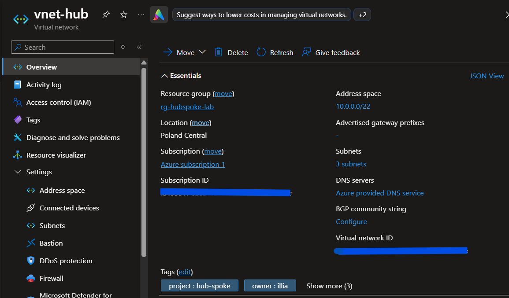
 
---

### Step 3 — Create the dev virtual network

Click **Virtual networks → Create**. On the **Basics** tab:

| Setting                | Value                  |
| ---------------------- | ---------------------- |
| `Subscription`         | `Azure subscription 1` |
| `Resource group`       | `rg-hubspoke-lab`      |
| `Virtual network name` | `vnet-dev`             |
| `Region`               | `Poland Central`       |

On the **IP addresses** tab:

| Setting              | Value          |
| -------------------- | -------------- |
| `IPv4 address space` | `10.1.0.0/16`  |
 
Add the subnet:
 
| Setting                          | Value                  |
| -------------------------------- | ---------------------- |
| `Subnet name`                    | `snet-dev-workload`    |
| `Starting address`               | `10.1.1.0`             |
| `Size`                           | `/24`                  |
| `Private subnet (no default outbound access)` | `Enabled` |

Add the tags, click **Review + create**, then **Create**.

**Result:** an isolated network for the development environment.

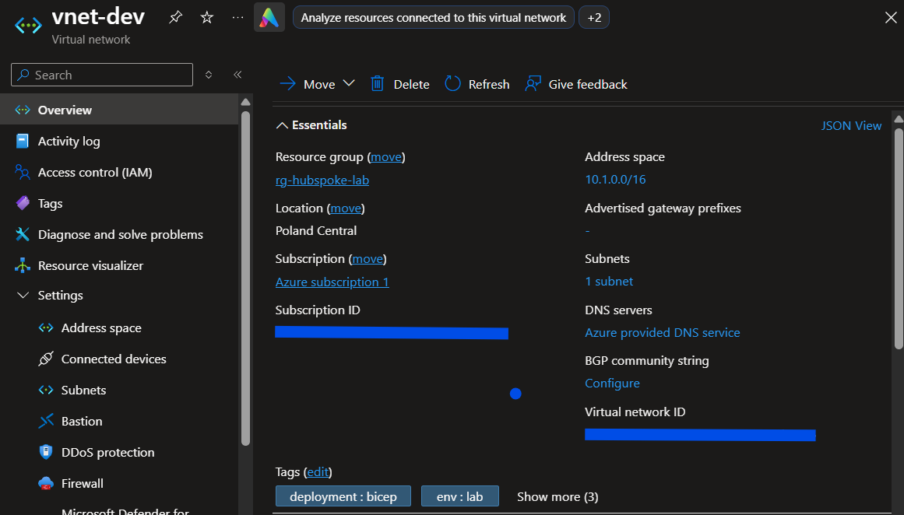

### Step 4 — Create the prod virtual network

Repeat Step 3 with these values:


| Setting                                       | Value             |
| --------------------------------------------- | ----------------- |
| `Virtual network name`                        | `vnet-prod`       |
| `IPv4 address space`                          | `10.2.0.0/16`     |
| `Subnet name`                                 | `snet-prod-web`   |
| `Starting address`                            | `10.2.1.0`        |
| `Size`                                        | `/24`             |
| `Private subnet (no default outbound access)` | `Enabled`         |
 
**Result:** an isolated network for production. The three address ranges do not overlap, which is required for peering.
 
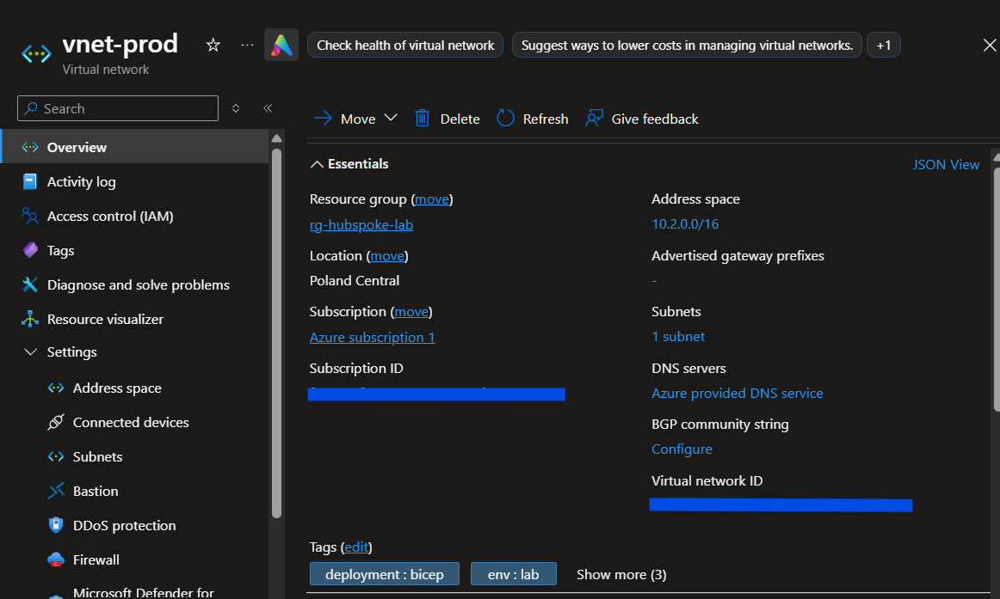

---

### Step 5 — Create the VNet peering

 
Peering connects the hub with each spoke. There is **no** peering between `vnet-dev` and `vnet-prod`. Peering is not transitive, so the environments can reach each other only through the hub.
 
Open **Virtual networks → `vnet-hub` → Peerings → Add**. Configure the peering to dev:
 
| Setting                                                          | Value          |
| ---------------------------------------------------------------- | -------------- |
| `Peering link name` (this network, hub → dev)                    | `hub-to-dev`   |
| `Allow 'vnet-hub' to access 'vnet-dev'`                          | `Enabled`      |
| `Allow 'vnet-hub' to receive forwarded traffic from 'vnet-dev'`  | `Enabled`      |
| `Allow gateway or route server in 'vnet-hub' to forward traffic` | `Disabled`     |
| `Enable 'vnet-hub' to use 'vnet-dev' remote gateway`             | `Disabled`     |
| `Remote virtual network`                                         | `vnet-dev`     |
| `Peering link name` (remote network, dev → hub)                  | `dev-to-hub`   |
| `Allow 'vnet-dev' to access 'vnet-hub'`                          | `Enabled`      |
| `Allow 'vnet-dev' to receive forwarded traffic from 'vnet-hub'`  | `Enabled`      |
 
Click **Add**.
 
Repeat for prod:
 
| Setting                                                          | Value                   |
| ---------------------------------------------------------------- | ----------------------- |
| `Peering link name` (hub → prod)                                 | `hub-to-prod`           |
| `Remote virtual network`                                         | `vnet-prod`             |
| `Peering link name` (prod → hub)                                 | `prod-to-hub`           |
| Access and forwarded traffic settings                            | `Enabled` on both sides |
  
Check that the **Peering status** is `Connected` for all four peerings.
 
**Result:** the hub is connected to both spokes. Traffic between the spokes is still impossible.
 

 

 
---

### Step 6 — Create the application security group and NSGs
 
#### Application security group
 
In the search bar, enter:
 
```text
Application security groups
```
 
Click **Application security groups → Create**:
 
| Setting          | Value                   |
| ---------------- | ----------------------- |
| `Subscription`   | `Azure subscription 1`  |
| `Resource group` | `rg-hubspoke-lab`       |
| `Name`           | `asg-web`               |
| `Region`         | `Poland Central`        |
 
Add the tags, click **Review + create**, then **Create**.
 
**Result:** a label for "all web servers". NSG rules will use it instead of IP addresses.
 
An Application Security Group (ASG) is a label for a group of virtual machines that can be used in NSG rules instead of IP addresses. On its own it does nothing and costs nothing: it is just the name of a role, for example "web servers".

Without an ASG, a rule in `nsg-prod` would have to be written for specific addresses, such as "allow traffic to `10.2.1.4` and `10.2.1.5`", and edited every time a new server appears or an IP changes. With an ASG, the rule reads "allow traffic to `asg-web`", and a new VM simply gets the label and immediately falls under the rule, with no changes to the NSG itself.

In this project we create `asg-web`, attach the network interface of `vm-prod-01` to it, and then use it as the Destination in the `allow-dev-web` rule. This way the rules describe the role of a server rather than its address, which is cleaner, scales better and matches the modern approach to micro-segmentation.

ASGs should be used when a network contains multiple VMs with the same role that share the same access rules. In this case, instead of a list of IP addresses, you simply enter a single tag into the NSG; this eliminates the need to modify the rule whenever servers are added, removed, or have their addresses changed. Typical examples include: `asg-web` (ports 80 and 443), `asg-db` (port 1433 or 5432, accessible only from `asg-web`), and `asg-app`.

Conversely, if you have only one or two VMs with distinct roles, ASGs are unnecessary; a standard rule based on an IP address or subnet will suffice. In this lab, we use them primarily for demonstration purposes—using two production-style VMs helps illustrate the core principle: the rule is tied to a role, not an address.

One limitation: an ASG works only within a single VNet, so for traffic coming from dev the source is defined by the range `10.1.0.0/16`, while `asg-web` is used as the destination in prod.

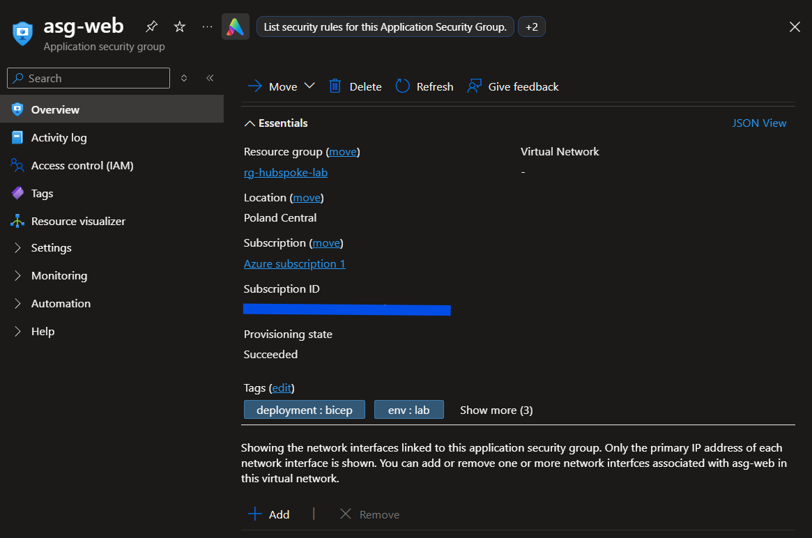
 
#### NSG for dev

In the search bar, enter:
 
```text
Network security groups
```
 
Click **Network security groups → Create**:
 
| Setting                 | Value                  |
| ----------------------- | ---------------------- |
| `Subscription`          | `Azure subscription 1` |
| `Resource group`        | `rg-hubspoke-lab`      |
| `Name`                  | `nsg-dev`              |
| `Region`                | `Poland Central`       |
 
Add the tags, click **Review + create**, then **Create**.

**What this does:** creates an empty Network Security Group, a virtual firewall for a subnet. At this point it only has the default rules and is not attached to anything, so it does not filter any traffic yet.
 
Open `nsg-dev` → **Inbound security rules → Add** and create the rules:
 
| Priority | Name                  | Source         | Source port | Destination | Dest. port | Protocol | Action |
| -------- | --------------------- | -------------- | ----------- | ----------- | ---------- | -------- | ------ |
| `100`    | `allow-bastion-ssh`   | `10.0.0.64/26` | `*`         | `Any`       | `22`       | `TCP`    | Allow  |
| `4000`   | `deny-all-inbound`    | `Any`          | `*`         | `Any`       | `*`        | `Any`    | Deny   |
 
Dev accepts nothing from prod. Administration from Bastion is the only exception.
  
**What this does:** defines who may connect to the dev subnet. Rules are checked from the lowest priority number to the highest, and the first match wins. The first rule lets SSH (port 22) in only from `AzureBastionSubnet` (`10.0.0.64/26`), so the only way to administer the dev VM is through Bastion. The second rule, at priority `4000`, denies everything else. It sits before the default `AllowVnetInBound` rule (`65000`), so it overrides it and blocks traffic coming from the peered networks as well. The result is a default-deny policy with a single explicit exception.

Open `nsg-dev` → **Subnets → Associate** and select `vnet-dev` / `snet-dev-workload`.

**What this does:** attaches the NSG to the dev workload subnet. Until this step the rules exist but are not enforced. From now on every VM in `snet-dev-workload` is protected by `nsg-dev`, without configuring each VM separately.
 
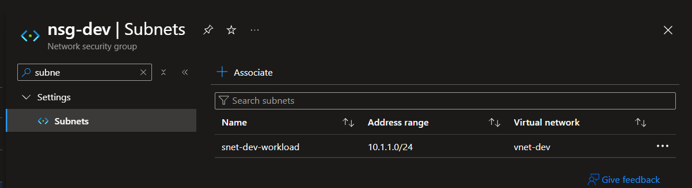
 
#### NSG for prod
 
Create `nsg-prod` in the same way and add the inbound rules:
 
| Priority | Name                  | Source         | Source port | Destination        | Dest. port | Protocol | Action |
| -------- | --------------------- | -------------- | ----------- | ------------------ | ---------- | -------- | ------ |
| `100`    | `allow-dev-web`       | `10.1.0.0/16`  | `*`         | `asg-web`          | `80,443`   | `TCP`    | Allow  |
| `110`    | `allow-bastion-ssh`   | `10.0.0.64/26` | `*`         | `Any`              | `22`       | `TCP`    | Allow  |
| `4000`   | `deny-all-inbound`    | `Any`          | `*`         | `Any`              | `*`        | `Any`    | Deny   |
 
**What this does:** creates the NSG for the production subnet and defines who may connect to it. Rules are evaluated from the lowest priority number to the highest, and the first match wins. The first rule allows web traffic (ports 80 and 443) only from the dev range `10.1.0.0/16`, and only to servers labeled `asg-web`, so the rule follows the role of the server rather than its IP address. The second rule allows SSH only from `AzureBastionSubnet`, so administration is possible only through Bastion. The third rule denies everything else, including traffic from the peered networks that the default `AllowVnetInBound` rule would otherwise let in.

Associate `nsg-prod` with `vnet-prod` / `snet-prod-web`.

**What this does:** attaches the NSG to the prod subnet. Until this step the rules exist but are not enforced. From now on every VM in `snet-prod-web` is protected by `nsg-prod`, without configuring each VM separately.

**Result:** the second layer of defense. Prod accepts only web traffic from dev and SSH from Bastion.
 
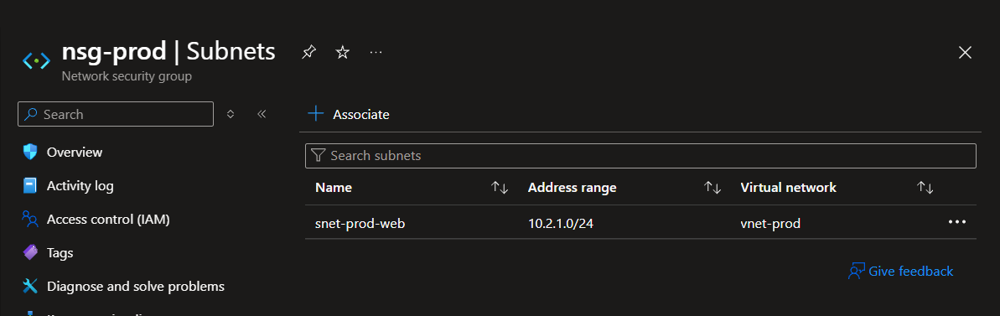
    
---

### Step 7 — Create the virtual machines

In the search bar, enter:
 
```text
Virtual machines
```
 
Click **Virtual machines → Create → Azure virtual machine**. On the **Basics** tab for the dev VM:
 
| Setting                 | Value                                         |
| ----------------------- | --------------------------------------------- |
| `Subscription`          | `Azure subscription 1`                        |
| `Resource group`        | `rg-hubspoke-lab`                             |
| `Virtual machine name`  | `vm-dev-01`                                   |
| `Region`                | `Poland Central`                              |
| `Availability options`  | `No infrastructure redundancy required`       |
| `Image`                 | `Ubuntu Server 24.04 LTS`                     |
| `Size`                  | `Standard_B2ats_v2 - 2 vcpus, 1 GiB memory `  |
| `Authentication type`   | `SSH public key` (or password)                |
| `SSH Key Type`          | `Ed25519 SSH Format`                          |
| `Username`              | `azureuser`                                   |
| `Public inbound ports`  | `None`                                        |
  
**What this does:** defines the virtual machine itself. Ubuntu Server is free, lightweight and managed over SSH, and a small B-series size keeps the cost to a few cents per hour. Authentication uses an SSH key, which cannot be guessed or brute-forced like a password, and the private key stays on my computer. `Public inbound ports: None` is important: it stops Azure from creating a rule that exposes SSH to the internet, because the only way to reach the VM will be Azure Bastion.


On the **Networking** tab:

| Setting                       | Value                |
| ----------------------------- | -------------------- |
| `Virtual network`             | `vnet-dev`           |
| `Subnet`                      | `snet-dev-workload`  |
| `Public IP`                   | `None`               |
| `NIC network security group`  | `None` (the subnet NSG is used) |

**What this does:** places the VM's network interface in the dev subnet, so it receives a private address from `10.1.1.0/24` and falls under `nsg-dev`. With no public IP the VM is invisible from the internet. No separate NSG is attached to the interface, because the subnet-level NSG already protects every VM in the subnet and one place to manage rules is easier to audit.

**Note:** Enabling **auto-shutdown** is recommended for lab VMs to avoid  paying for forgotten machines and to keep costs predictable. In this project it is not enabled, because the feature is not available in the `Poland Central` region (the Portal shows "The selected region does not support auto-shutdown"). Instead, the VMs are stopped manually after testing: open the VM and click **Stop**, and make sure the status is **Stopped (deallocated)**, because only then compute is not billed.
 
Add the tags, click **Review + create**, then **Create**.
 
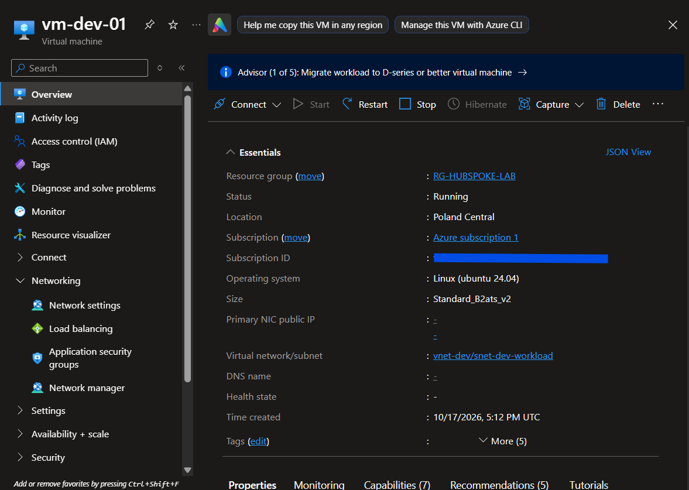

Create the prod VMs in the same way:
 
| Setting                | `vm-prod-01`                                           | 
| ---------------------- | ------------------------------------------------------ | 
| `Virtual network`      | `vnet-prod`                                            | 
| `Subnet`               | `snet-prod-web`                                        | 
| `Public IP`            | `None`                                                 | 
| `Public inbound ports` | `None`                                                 | 
| `Auto-shutdown`        | `Not available in Poland Central (see the note above)` | 

> A second prod VM would better demonstrate how `asg-web` applies a rule to a group of servers, but the subscription has VM quota limits in this region, so a single prod VM is used.

**What this does:** creates the target of the connectivity tests. The settings are the same as for dev, only the network and subnet differ, so the VM falls under `nsg-prod` and the rules defined for the production subnet.

#### Add the prod VM to the ASG
 
Open `vm-prod-01` → **Networking → Network interface → Application security groups**, select `asg-web` and save.
 
**What this does:** labels the VM's network interface as a web server. The `allow-dev-web` rule in `nsg-prod` uses `asg-web` as its destination, so this single step is what makes the rule apply to the VM. Without it the group is empty and dev cannot reach prod, even though everything else is configured. Any future web server only needs the same label, and the rule does not have to change.

**Result:** two VMs without public IPs. The prod VM is labeled as web servers, so the `allow-dev-web` rule applies to them.
 
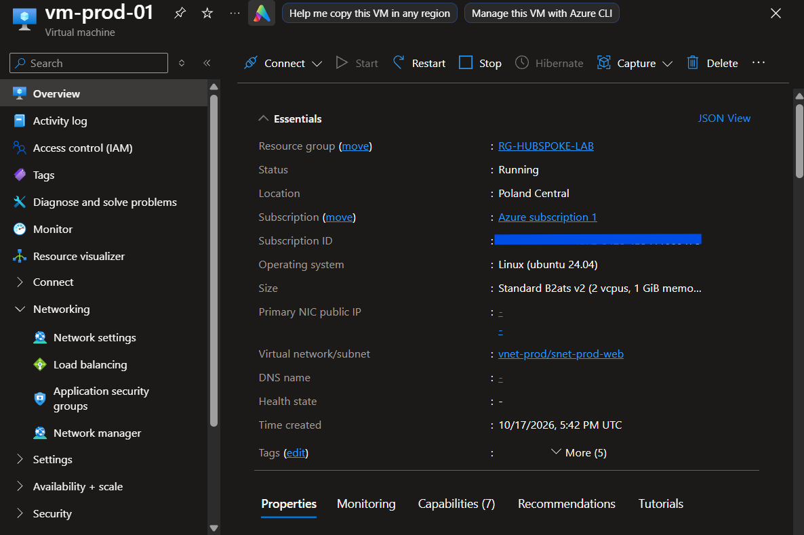

#### Check phase 1
 
- [x] Three VNets with non-overlapping ranges
- [x] All peerings are `Connected`
- [x] No peering between `vnet-dev` and `vnet-prod`
- [x] VMs have **no public IP** (check **Virtual machines → Public IP address** column)
- [x] NSGs are associated with the workload subnets

---
 
## Phase 2 — Firewall, routing and Bastion (paid)
 
### Step 8 — Create the Log Analytics workspace
 
In the search bar, enter:
 
```text
Log Analytics workspaces
```
 
Click **Log Analytics workspaces → Create**:
 
| Setting          | Value                  |
| ---------------- | ---------------------- |
| `Subscription`   | `Azure subscription 1` |
| `Resource group` | `rg-hubspoke-lab`      |
| `Name`           | `law-hubspoke`         |
| `Region`         | `Poland Central`       |
 
Add the tags, click **Review + create**, then **Create**.
 
**What this does:** creates an empty storage for logs. The pricing tier is Pay-as-you-go, so the cost depends only on how much data is sent to it, and an empty workspace costs nothing. The workspace collects nothing on its own: it starts receiving data only after diagnostic settings are enabled on the Firewall (Step 13).

**Result:** a place where the Firewall writes its logs, so each decision can be proved later with a query.
 
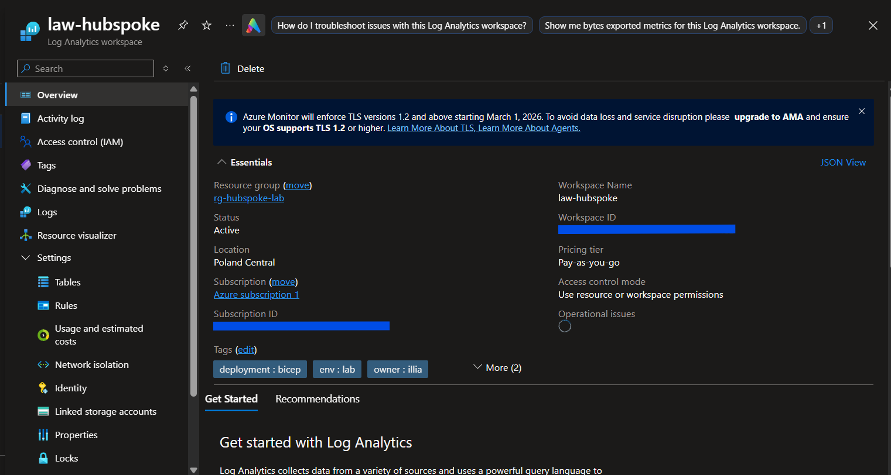
 
---

### Step 9 — Create Azure Firewall
 
In the search bar, enter:
 
```text
Firewalls
```
 
Click **Firewalls → Create**. On the **Basics** tab:
 
| Setting                                     | Value                                           |
| ------------------------------------------- | ----------------------------------------------- |
| `Subscription`                              | `Azure subscription 1`                          |
| `Resource group`                            | `rg-hubspoke-lab`                               |
| `Name`                                      | `afw-hub`                                       |
| `Region`                                    | `Poland Central`                                |
| `Firewall SKU`                              | `Basic`                                         |
| `Firewall policy`                           | `Add new` → `afwp-hub`                          |
| `Choose a virtual network`                  | `Use existing` → `vnet-hub`                     |
| `Public IP address`                         | `Add new` → `pip-afw-hub`                       |
| `Management public IP address` (Basic only) | `Add new` → `pip-afw-mgmt`                      |
 
> The Firewall subnet is selected automatically if `AzureFirewallSubnet` exists. The management subnet and IP are required only for the Basic SKU. Basic is enough for this project, because it uses network and application rules.
 
**What this does:** deploys a managed firewall into the hub. It gets a private address from `AzureFirewallSubnet` and a public IP for outbound internet traffic. With the Basic SKU, Azure also uses a separate management subnet and management public IP, so the platform can manage the firewall independently from customer traffic. The rules do not live on the firewall itself but in the firewall policy `afwp-hub`, which can be reused or changed separately.

Add the tags, click **Review + create**, then **Create**. The deployment takes several minutes.
 
When it is done, open the Firewall → **Overview** and write down the **Private IP address**. It is needed for the route tables.
 
| Value                  | Result       |
| ---------------------- | ------------ |
| Firewall private IP    | `10.0.0.4`   |
 
**What this does:** the private IP is the address that the spoke subnets will send their traffic to. It is the "next hop" in the route tables created in Step 11.

**Result:** the central control point in the hub.
 
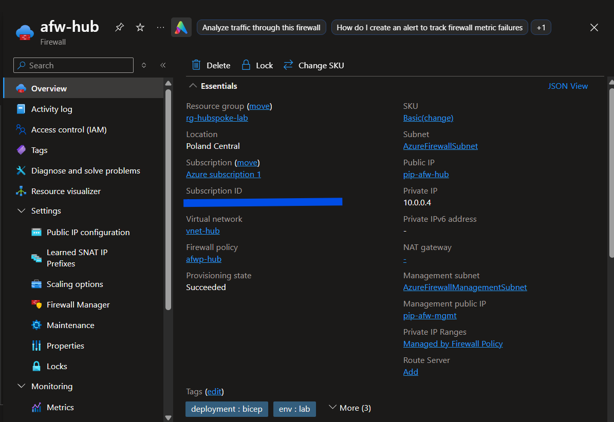

--- 

### Step 10 — Configure the Firewall policy
 
Open **Firewall policies → `afwp-hub`**.
 
#### Network rule: dev to prod
 
Open **Network rules → Add a rule collection**:
 
| Setting                 | Value                               |
| ----------------------- | ----------------------------------- |
| `Name`                  | `net-rules`                         |
| `Rule collection type`  | `Network`                               |
| `Priority`              | `100`                               |
| `Rule collection action`| `Allow`                             |
| `Rule collection group` | `DefaultNetworkRuleCollectionGroup` |
 
Add the rule:
 
| Setting             | Value              |
| ------------------- | ------------------ |
| `Name`              | `dev-to-prod-web`  |
| `Source`            | `10.1.0.0/16`      |
| `Protocol`          | `TCP`              |
| `Destination ports` | `80, 443`          |
| `Destination`       | `10.2.0.0/16`      |
 
**What this does:** allows only one flow between the environments: web traffic from the dev range to the prod range. Rules are grouped into collections, and a collection has a priority, so a lower number is checked first. Because this is the only allow rule between dev and prod, everything else between them (other ports, traffic from prod to dev) stays blocked.

#### Application rule: Ubuntu updates
 
Open **Application rules → Add a rule collection**:
 
| Setting                 | Value              |
| ----------------------- | ------------------ |
| `Name`                  | `app-rules`        |
| `Rule collection type`  | `Application`      |
| `Priority`              | `200`              |
| `Rule collection action`| `Allow`            |
| `Rule collection group` | `DefaultApplicationRuleCollectionGroup` |
 
Add the rule:
 
| Setting             | Value                                                                       |
| ------------------- | --------------------------------------------------------------------------- |
| `Name`              | `ubuntu-updates`                                                            |
| `Source`            | `10.1.0.0/16, 10.2.0.0/16`                                                  |
| `Protocol`          | `http:80, https:443`                                                        |
| `Destination type`  | `FQDN`                                                                      |
| `Destination`       | `azure.archive.ubuntu.com`                                                  |
 
**What this does:** lets the VMs download operating system updates and packages (for example `apt install nginx`), but only from the Ubuntu mirror that the default Ubuntu images on Azure use, `azure.archive.ubuntu.com`. The destination is identified by its domain name rather than an IP address, so the rule keeps working when the mirror's IP addresses change. Any other website is not allowed, so a request to it is dropped and logged.

Everything that matches no rule is **denied by default**, so no extra deny rule is needed.
 
**Result:** only the allowed flows pass. Everything else is blocked and logged.
 
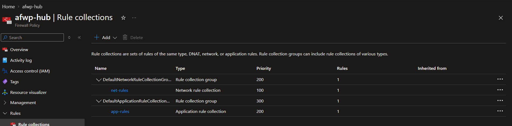
 
---

### Step 11 — Create the route tables
 
In the search bar, enter:
 
```text
Route tables
```
 
Click **Route tables → Create**:
 
| Setting                      | Value                  |
| ---------------------------- | ---------------------- |
| `Subscription`               | `Azure subscription 1` |
| `Resource group`             | `rg-hubspoke-lab`      |
| `Region`                     | `Poland Central`       |
| `Name`                       | `rt-dev`               |
| `Propagate gateway routes`   | `No`                   |
 
Add the tags, click **Review + create**, then **Create**.
 
**What this does:** Propagate gateway routes is set to No so that routes learned from a VPN or ExpressRoute gateway cannot override the custom 0.0.0.0/0 route to the Firewall. There is no gateway in this lab, but the setting guarantees that all traffic stays under the Firewall’s control. 

Open `rt-dev` → **Routes → Add**:
 
| Setting                    | Value                           |
| -------------------------- | ------------------------------- |
| `Route name`               | `default-to-firewall`           |
| `Destination type`         | `IP Addresses`                  |
| `Destination IP addresses` | `0.0.0.0/0`                     |
| `Next hop address`         | `10.0.0.4`                      |
| `Next hop type`            | `Virtual appliance`             |
 
Open `rt-dev` → **Subnets → Associate** and select `vnet-dev` / `snet-dev-workload`.
 
**What this does:** The route `0.0.0.0/0` with the next hop type `Virtual appliance` and the address `10.0.0.4` (the private IP of Azure Firewall) sends all traffic that leaves the subnet to the Firewall. `0.0.0.0/0` means "any destination", so it matches everything that has no more specific route, such as the internet or the other spoke. Azure always chooses the most specific matching route, so traffic inside the same virtual network still stays local, and only the traffic that would otherwise bypass the hub is redirected. Without this route the traffic would go directly to its destination, and the Firewall rules would never be applied. With it, the Firewall becomes the single point where every connection is inspected, allowed or denied.

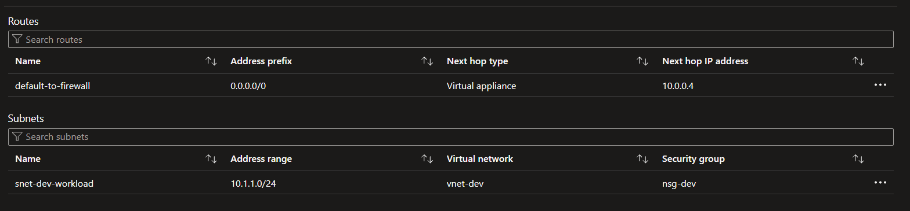
 
Create `rt-prod` in the same way, with the same route, and associate it with `vnet-prod` / `snet-prod-web`.
 
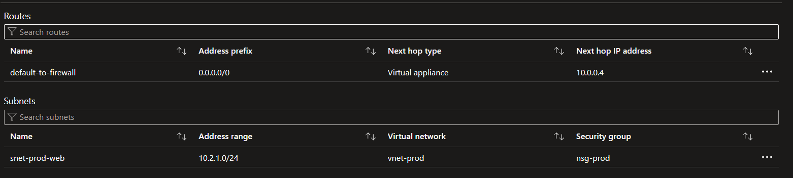
 
**Result:** everything that leaves a spoke goes to the Firewall. Because dev and prod are not peered, the address of the other spoke is unknown, so it also matches `0.0.0.0/0`.
 
> A route table that is not associated with a subnet does nothing. Check the **Subnets** tab of each route table.
 
---


### Step 12 — Create Azure Bastion
 
In the search bar, enter:
 
```text
Bastions
```
 
Click **Bastions → Create**:
 
| Setting                | Value                          |
| ---------------------- | ------------------------------ |
| `Subscription`         | `Azure subscription 1`         |
| `Resource group`       | `rg-hubspoke-lab`              |
| `Name`                 | `bas-hub`                      |
| `Region`               | `Poland Central`               |
| `Tier`                 | `Basic`                        |
| `Virtual network`      | `vnet-hub`                     |
| `Subnet`               | `AzureBastionSubnet`           |
| `Public IP address`    | `Create new` → `vnet-hub-IPv4` |
  
Add the tags, click **Review + create**, then **Create**.
 
**Result:** secure access to the VMs through the browser. No SSH port is open to the internet.
 
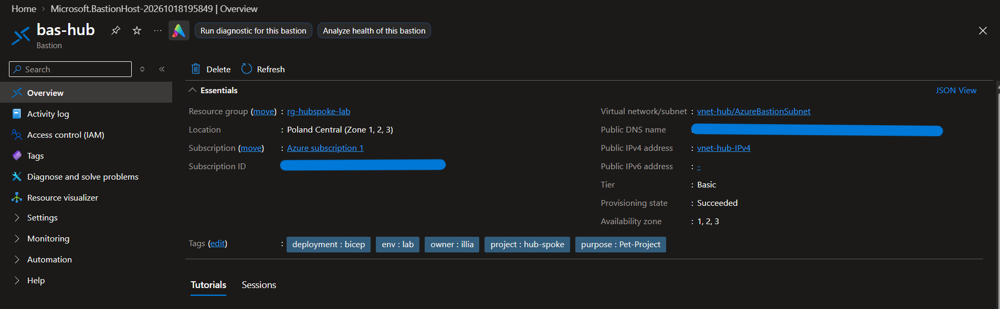
 
---
 
### Step 13 — Send Firewall logs to Log Analytics
 
Open the Firewall `afw-hub` → **Monitoring → Diagnostic settings → Add diagnostic setting**:
 
| Setting                  | Value                                                            |
| ------------------------ | ---------------------------------------------------------------- |
| `Diagnostic setting name`| `diag-afw-to-law`                                                |
| `Logs`                   | Select Network rule, Application rule and DNS logs, or `allLogs` |
| `Destination`            | `Send to Log Analytics workspace`                                |
| `Subscription`           | `Azure subscription 1`                                           |
| `Log Analytics workspace`| `law-hubspoke`                                                   |
| `Destination table`      | `Resource specific`                                              |
 
Click **Save**.
 
**What this does:** Azure Firewall does not store its own logs, so this diagnostic setting streams them to the Log Analytics workspace `law-hubspoke`. The selected categories (network rule, application rule and DNS logs) record every connection that the Firewall allows or denies, which makes it possible to prove that the rules work and to troubleshoot blocked traffic with KQL queries. The destination table type `Resource specific` stores each log category in its own table with structured columns (for example `AZFWNetworkRule` and `AZFWApplicationRule`), which is easier to query than the single `AzureDiagnostics` table. Logs appear a few minutes after the Firewall processes traffic, so the tables stay empty until a workload generates some.

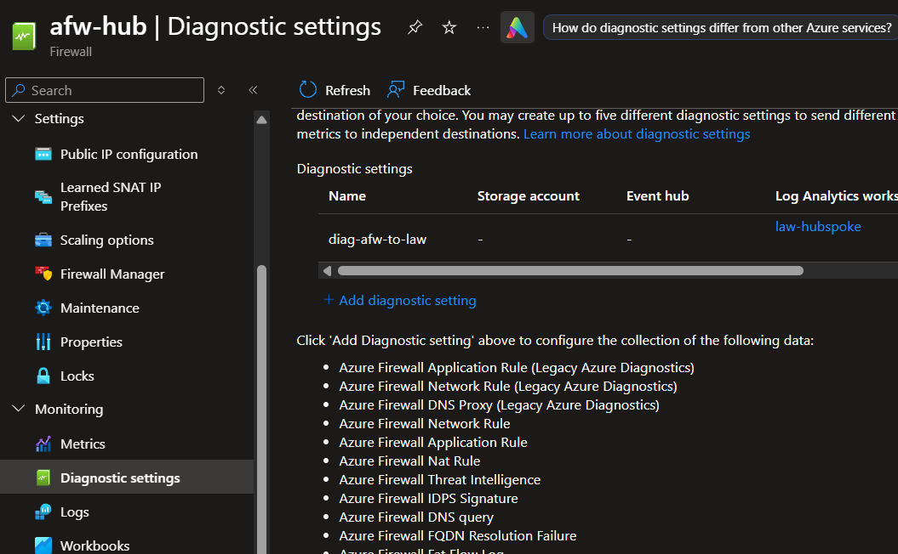
 
#### Install a test web server on the prod VM
 
The prod VMs must answer web requests, otherwise the dev to prod test proves nothing.
 
1. Open **Virtual machines → `vm-prod-01` → Connect → Connect via Bastion**.
2. Sign in with the SSH Private Key from Local File and select the .pem file”.
3. Run:
```bash
sudo apt update
sudo apt install -y nginx
systemctl status nginx --no-pager
curl -s localhost | head -n 5
```
 
`apt update` goes to the internet. It works only because the application rule allows the Ubuntu repositories, so this step already tests the rule.
 
#### Check phase 2
 
- [x] Firewall is `Succeeded` and has a private IP
- [x] Route tables point to the Firewall private IP and are associated with the spoke subnets
- [x] Bastion connects to the VMs from the Portal
- [x] Diagnostic logs are sent to the workspace

---
 
## Phase 3 — Governance and cost control
 
### Step 14 — Assign Azure Policy
 
In the search bar, enter:
 
```text
Policy
```
 
Click **Policy → Authoring → Assignments → Assign policy**. Create three assignments with scope `rg-hubspoke-lab`:

| Policy definition                                | Parameters                            | Effect |
| ------------------------------------------------ | ------------------------------------- | ------ |
| `Network interfaces should not have public IPs`  | -                                     | Deny   |
| `Require a tag on resources`                     | `Tag name`: `env`                     | Deny   |
| `Allowed locations`                              | `Allowed locations`: `Poland Central` | Deny   |
 
For each assignment: select the **Scope** → resource group, select the **Policy definition**, fill in **Parameters** and click **Review + create**, then **Create**.
 
**Result:** risky configurations are rejected at creation time.

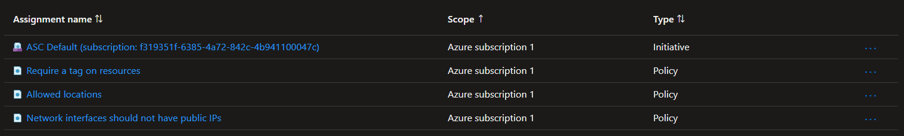

--- 
 
### Step 15 — Create a budget alert
 
In the search bar, enter:
 
```text
Cost Management
```
 
Click **Cost Management → Budgets → Add**:
 
| Setting            | Value                                  |
| ------------------ | -------------------------------------- |
| `Scope`            | Subscription (or `rg-hubspoke-lab`)    |
| `Name`             | `budget-hubspoke-lab`                  |
| `Reset period`     | `Monthly`                              |
| `Amount`           | `<amount you are ready to spend>`      |
 
On the **Set alerts** page:
 
| Alert condition            | Value                 |
| -------------------------- | --------------------- |
| `Actual cost`, `% of budget` | `50`, `80`, `100`   |
| `Alert recipients (email)` | `<your email>`        |
 
Click **Create**.
 
**Result:** an email arrives before the spending gets out of control.
 
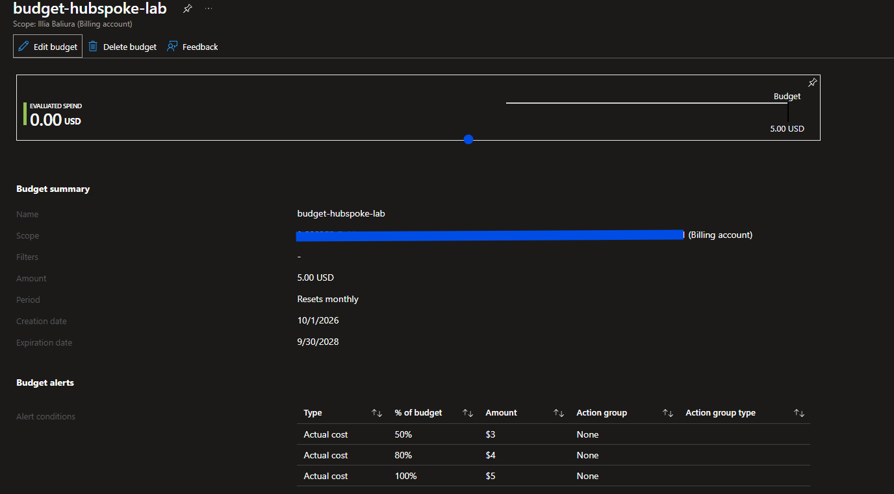

---
 
## Result of the Portal deployment
 
Open **Resource group → Overview** and check that all resources are in place.
 
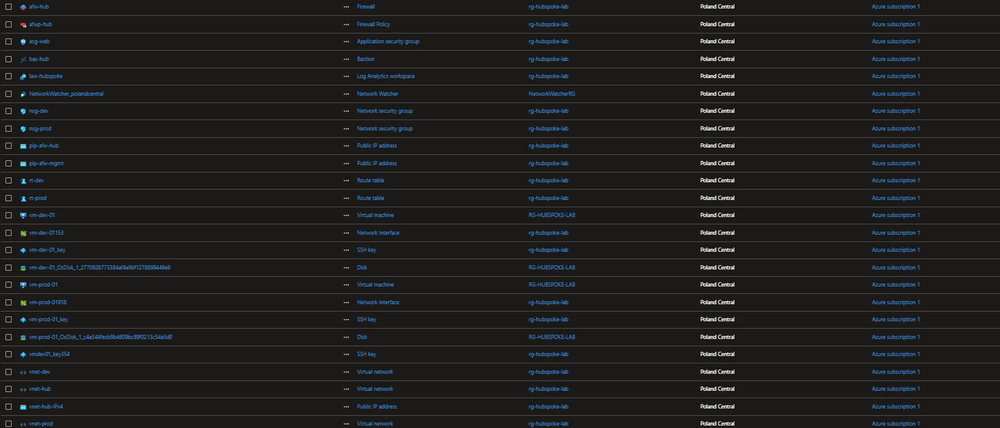
 
## Verification

The tests below prove that the hub-and-spoke design works: traffic between the spokes is controlled by the Firewall, allowed traffic passes, and everything else is blocked. Run them in one session while the Firewall and Bastion exist, then delete the expensive resources (see [Clean up](#clean-up)).

**Before you start:**

- `afw-hub` and `bas-hub` are `Succeeded`.
- Both VMs are running (status **Running**, not Stopped (deallocated)).
- `nginx` is installed on `vm-prod-01` (see Step 13).
- Note the private IP address of `vm-prod-01`: open the VM → **Overview** → **Private IP address**. It is used below as `<prod-private-ip>`.

### Test 1 — Peering is connected

Open **Virtual networks → `vnet-hub` → Peerings**.

**Expected:** both peerings (`dev-to-hub`, `prod-to-hub,`) show `Connected`.

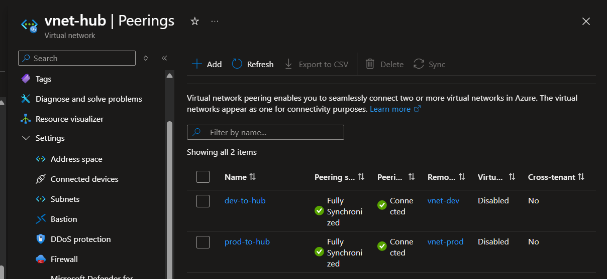

### Test 2 — Traffic is routed through the Firewall

Open **Virtual machines → `vm-dev-01` → Networking → Network settings**, open the network interface, then **Help → Effective routes**.

**Expected:** a route with the prefix `0.0.0.0/0`, the next hop type `Virtual appliance` and the next hop `10.0.0.4`, with the source `User`.

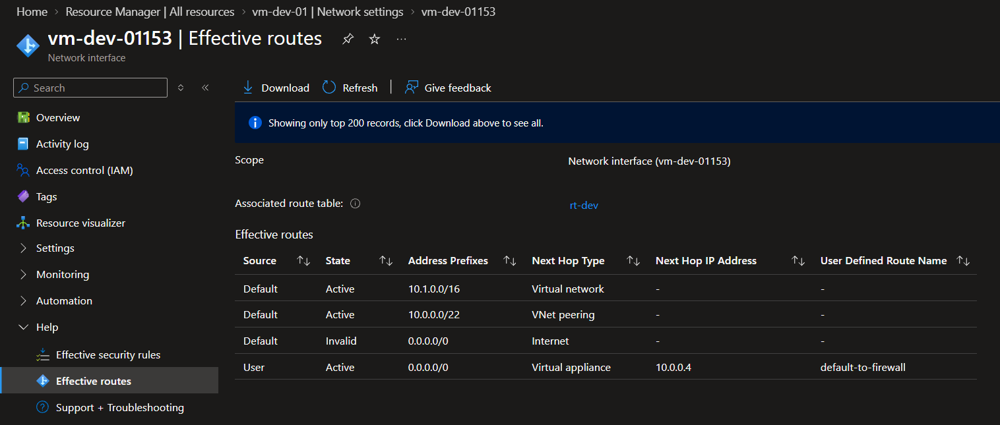

**What this does:** effective routes show what the network actually uses after Azure combines system routes and the custom route table. This proves that `rt-dev` is applied and the Firewall is the next hop.

### Test 3 — Allowed traffic: dev to prod over HTTP

Connect to `vm-dev-01` with **Connect → Connect via Bastion** and run:

```bash
curl -s --max-time 10 http://10.2.1.4 | head -n 5
```

**Expected:** the HTML of the default nginx page.

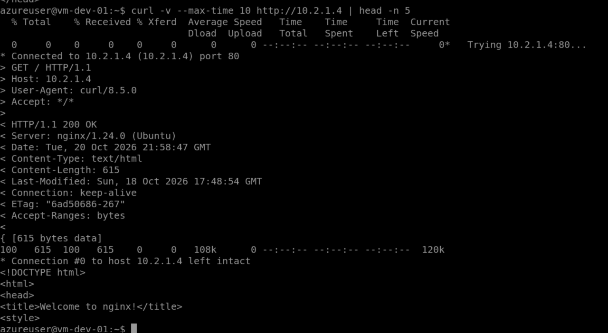

**What this does:** the packet goes from the dev subnet to the Firewall (route table), matches the network rule `dev-to-prod-web` (ports 80 and 443) and is forwarded to prod over the hub-to-prod peering.

### Test 4 — Denied traffic: everything that is not allowed

From `vm-dev-01` run:

```bash
ping -c 3 10.2.1.4
curl -s --max-time 5 http://10.2.1.4:8080 ; echo "exit code: $?"
```

**Expected result:** `ping` receives no replies and `curl` to port `8080` times out (exit code `28`). Neither ICMP nor port `8080` is allowed by any rule, so the Firewall drops the packets (deny by default).

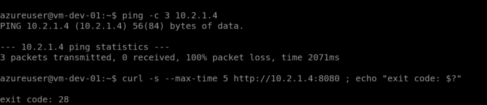

**What this does:** the Firewall denies traffic by default. ICMP and port 8080 are not in any rule, so the packets are dropped.

### Test 5 — Application rule: Ubuntu updates

On any VM run:

```bash
sudo apt update
```

**Expected:** the package lists are downloaded without errors.

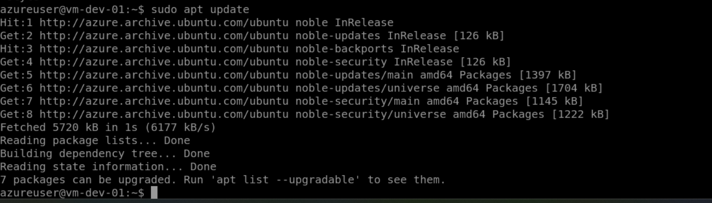

**What this does:** the VM has no public IP, so the request goes through the Firewall, where the application rule `ubuntu-updates` allows only one domain, `azure.archive.ubuntu.com`, the Ubuntu mirror used by the default Ubuntu images on Azure. Every other domain stays blocked.

### Test 6 — Other websites are blocked

On the same VM run:

```bash
curl -s --max-time 5 -I https://youtube.com ; echo "exit code: $?"
```

**Expected:** the request fails (`curl` exit code `35` for a TLS connection reset or `28` for a timeout). The Firewall inspects the requested domain name and terminates connections to every domain that is not in the application rule.

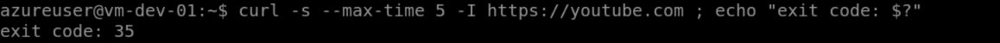

**What this does:** only the domains from the application rule are allowed. Every other destination is denied, which shows that the Firewall controls outbound traffic by domain name.

### Test 7 — Firewall logs in Log Analytics

Wait 5–10 minutes, then open **Log Analytics workspaces → `law-hubspoke` → Logs** and run the query:

```kusto
let net = AZFWNetworkRule
| project TimeGenerated, Type="Network", SourceIp, Target=DestinationIp, Port=DestinationPort, Protocol, Action, Rule;
let app = AZFWApplicationRule
| project TimeGenerated, Type="Application", SourceIp, Target=Fqdn, Port=DestinationPort, Protocol, Action, Rule;
union net, app
| where TimeGenerated > ago(3h)
| summarize Hits=count(), Last=max(TimeGenerated) by Type, SourceIp, Target, Port, Protocol, Action, Rule
| order by Last desc
```

**Expected:** rows with the actions `Allow` (Tests 3 and 5) and `Deny` (Tests 4 and 6), the source and destination addresses and the rule names.

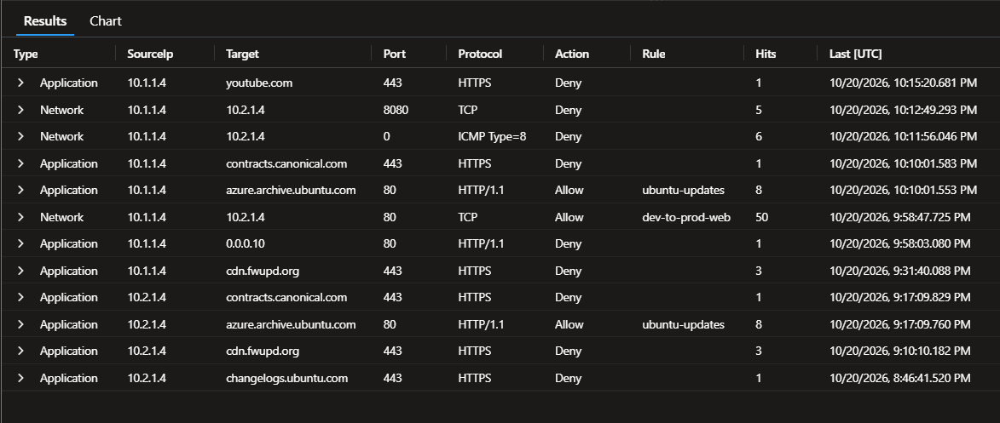

**What this does:** the diagnostic setting streams every decision of the Firewall to the workspace, so each test above can be confirmed in the logs, not only in the terminal.

### Test 8 — Azure Policy blocks risky configurations

In the search bar, enter `Public IP addresses`, click **Create** and fill in the basic fields in `rg-hubspoke-lab` (for example the name `pip-policy-test`). On the **Tags** tab leave the tag `env` **empty**, then click **Review + create**.

**Expected:** validation fails with the error `RequestDisallowedByPolicy`, and the error details name the policy `Require a tag on resources`.

```text
Resource 'pip-policy-test' was disallowed by policy.
Code: RequestDisallowedByPolicy
Policy: Require a tag on resources
```

Result: The test confirmed that the Require a tag on resources policy is enforced at the selected scope. Azure prevented the resource from being created because it did not satisfy the mandatory tagging requirements.

Evidence: The Azure Portal validation error showing RequestDisallowedByPolicy and the policy name.

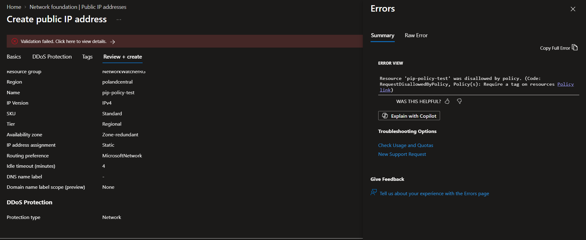

**What this does:** the policy is evaluated when the deployment is validated, so the non-compliant resource is never created. This proves that the rules for tags, regions and public IPs on network interfaces are enforced by Azure itself, not by convention.

### Clean up

Azure Firewall and Azure Bastion are billed per hour for as long as they exist, so delete them as soon as the tests are finished. The rest of the lab (virtual networks, peerings, NSGs, route tables, Log Analytics, policies) costs almost nothing and can stay.

#### Option 1 — Delete only the expensive resources

1. Open **Resource groups → `rg-hubspoke-lab`**, select **Azure Firewall** (`afw-hub`) and **Azure Bastion** (`bas-hub`), and click **Delete**.
2. Delete the public IP addresses. They are separate resources and **are not removed together with the Firewall or Bastion**, and a Standard public IP is billed even when nothing uses it. Open **Public IP addresses**, filter by `rg-hubspoke-lab` and delete every address with an empty **Associated to** column (`pip-afw-hub`, `pip-afw-mgmt` and the Bastion address).
3. Stop the virtual machines: open each VM, click **Stop** and make sure the status is **Stopped (deallocated)**.
4. Keep the firewall policy `afwp-hub`: it holds the rules, costs nothing and can be attached to a new Firewall later.
5. Open **Cost Management → Cost analysis** and check that no unexpected charges appear.

> Route tables point to the Firewall private IP `10.0.0.4`. While the Firewall does not exist, spoke VMs lose internet access and cannot reach each other. This is expected.

#### Option 2 — Delete everything

Open **Resource groups → `rg-hubspoke-lab` → Delete resource group** and type the group name to confirm. All resources inside are removed, including the public IP addresses and the policy assignments scoped to this resource group.

## Deployment using Bicep (Infrastructure as Code)

The same environment that was built by hand in the Portal is described as code in `infrastructure/`. Every resource, setting and rule from the Portal guide has a counterpart in a Bicep module, so the whole lab can be rebuilt (or reviewed in a pull request) from the repository alone.

### What was created and why

| File | What it describes | Why it is a separate file |
| ---- | ----------------- | ------------------------- |
| `infrastructure/main.bicep` | Parameters, phase switches, tags, and the order in which modules are called | One entry point that wires everything together |
| `infrastructure/main.bicepparam` | Parameter values and the phase switches (`deployCompute`, `deployFirewall`, `deployBastion`, `deployPolicy`) | The desired state lives in git, so a change is reviewed in a pull request |
| `modules/monitoring.bicep` | Log Analytics workspace `law-hubspoke` | Firewall logs need a destination before the Firewall exists |
| `modules/routing.bicep` | Route tables `rt-dev`, `rt-prod` with `0.0.0.0/0` → Firewall private IP | Must exist **before** the network, because spoke subnets reference them |
| `modules/network.bicep` | 3 VNets, subnets, 4 peerings (no dev↔prod), NSGs, `asg-web` | The network foundation (Phase 1) |
| `modules/compute.bicep` | `vm-dev-01`, `vm-prod-01` (Ubuntu 24.04, SSH key only, no public IP) | Test workloads for the connectivity tests |
| `modules/firewall.bicep` | Azure Firewall (Basic), firewall policy, rules, diagnostic settings | The paid central control point (Phase 2) |
| `modules/bastion.bicep` | Azure Bastion (Basic) | Browser-based SSH without public IPs (Phase 2) |
| `modules/policy.bicep` | Three Azure Policy assignments (deny NIC public IPs, require `env` tag, allowed locations) | Governance (Phase 3), deployed last |

### One-time bootstrap (outside Bicep)
 
The resource group and the identity used by CI/CD are created once by a script, not by Bicep:
 
```powershell
az login
./scripts/bootstrap.ps1 -Owner <github-user> -Repo <repo-name>
```

Reasons:

1. **Chicken and egg.** `main.bicep` deploys *into* an existing resource group (`targetScope = 'resourceGroup'`), so the group must exist first.
2. **Least privilege.** The CI/CD identity gets `Contributor` and `Resource Policy Contributor` on this one resource group only. Creating a group needs rights on the whole subscription, so the pipeline deliberately cannot do it.
3. **Different lifecycles.** The group is a long-lived container; its content changes with every pull request.
4. **OIDC instead of passwords.** The script also creates three federated credentials (environment `lab`, branch `main`, pull requests), so GitHub Actions can log in to Azure without any stored secret.

Everything *inside* the group is Bicep. Scripts are used only for what Bicep cannot or should not do.

### Deploy in phases

Phases are controlled by switches in `main.bicepparam`, so the expensive Azure Firewall and Bastion are created only when needed.

| Phase | Switches | Creates | Cost |
| ----- | -------- | ------- | ---- |
| 1 | `deployCompute = true` | Network, NSG/ASG, peerings, route tables (empty), Log Analytics, VMs | Low |
| 2 | `deployFirewall = true`, `deployBastion = true` | Firewall + policy + rules + diagnostics, default route to the Firewall, Bastion | **Billed per hour** |
| 3 | `deployPolicy = true` | Azure Policy assignments | None |

```powershell
az login
$env:SSH_PUBLIC_KEY = (Get-Content ~/.ssh/id_ed25519.pub)

# 1. Preview: what would change (creates nothing)
az deployment group what-if -g rg-hubspoke-lab `
  -f infrastructure/main.bicep -p infrastructure/main.bicepparam

# 2. Deploy
az deployment group create -g rg-hubspoke-lab `
  -f infrastructure/main.bicep -p infrastructure/main.bicepparam
```

To move to the next phase, change the switch in `main.bicepparam`, run `what-if`, then deploy again.

### Design decisions in the code

| Decision | Rationale |
| -------- | --------- |
| Modules per function, wired in `main.bicep` | Each file has one responsibility and can be reviewed on its own |
| Route tables are created before the network | Subnets reference them; creating them after the Firewall would be a circular dependency |
| Firewall private IP is a parameter (`10.0.0.4`) | It is the first usable address of `AzureFirewallSubnet` (Azure reserves the first four). `main.bicep` outputs both the expected and the actual IP so a mismatch is visible |
| Default route is added only when `deployFirewall = true` | Otherwise traffic would be sent to a Firewall that does not exist |
| Conditional modules (`if (deployX)`) | Paid resources never appear by accident |
| Policy is deployed last | A policy with `Deny` effect must not block the deployment itself |
| Subnets use `defaultOutboundAccess = false` | VMs reach the internet only through the Firewall |
| Same tags everywhere, `deployment = bicep` | Resources from the Portal and Bicep phases can be told apart in Cost Management |

### Things to know about Bicep

- **Incremental mode never deletes.** Setting `deployFirewall = false` after the Firewall exists does not remove it. Delete the paid resources explicitly (below).
- **The code is the source of truth.** A manual change in the Portal can be overwritten by the next deployment.

### Clean up the paid resources

```powershell
az network firewall delete -g rg-hubspoke-lab -n afw-hub
az network bastion delete  -g rg-hubspoke-lab -n bas-hub
az network public-ip delete -g rg-hubspoke-lab -n pip-afw-hub
az network public-ip delete -g rg-hubspoke-lab -n pip-afw-mgmt
az network public-ip delete -g rg-hubspoke-lab -n pip-bas-hub
```

Then set `deployFirewall` and `deployBastion` back to `false` in `main.bicepparam`, otherwise the next deployment creates them again. The firewall policy `afwp-hub` is kept: it is free and holds the rules.

### CI

`.github/workflows/validate.yml` compiles the Bicep code on every pull request and on every push to `main`. A broken template is caught before it is merged.
